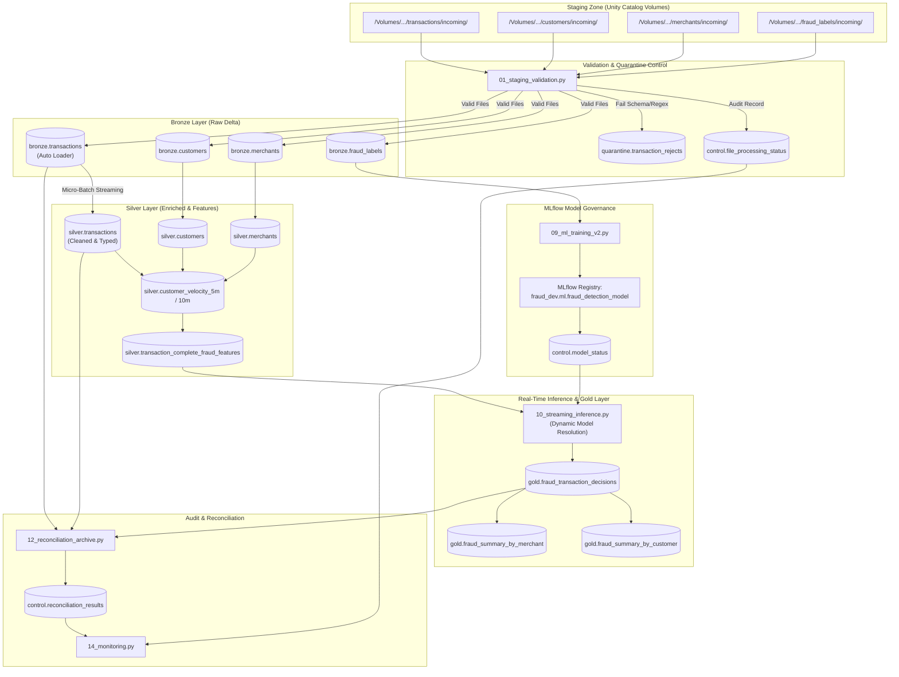

# Architecture & Engineering Specifications

## 1. System Overview

The **Real-Time Transaction Fraud & Anomaly Detection Platform** is a production-grade, enterprise Lakehouse architecture implemented on **Databricks**, **Apache Spark Structured Streaming**, **Delta Lake**, **Unity Catalog**, and **MLflow**.

The system addresses the high-throughput, low-latency requirements of financial institutions detecting suspicious payments, card-not-present anomalies, and high-velocity fraud rings.

---

## 2. Medallion Layer Design

### Staging Layer
- **Storage**: Unity Catalog Volumes (`/Volumes/fraud_dev/staging/source_files/`).
- **Function**: Secure external landing zone for incoming batch feeds, CSV streams, and streaming checkpoints.
- **Security**: Strict access control via Unity Catalog permissions.

### Bronze Layer (Raw Ingestion)
- **Streaming Ingestion**: Databricks **Auto Loader** (`cloudFiles`) with schema inference and evolution.
- **Target Tables**:
  - `fraud_dev.bronze.transactions`
  - `fraud_dev.bronze.customers`
  - `fraud_dev.bronze.merchants`
  - `fraud_dev.bronze.fraud_labels`
- **Guarantees**: Append-only, idempotent ingestion with automatic tracking of ingested source files.

### Silver Layer (Cleansing, Typing & Feature Store)
- **Structured Streaming Micro-Batches**: Processes incremental records from Bronze with schema enforcement.
- **Quarantine Engine**: Records failing type conversion, mandatory fields, or domain bounds are isolated in `fraud_dev.quarantine.transaction_rejects`.
- **Sliding Velocity Windows**:
  - `customer_velocity_5m`: 5-minute rolling window tracking transaction counts and cumulative volume per customer.
  - `customer_velocity_10m`: 10-minute rolling window capturing rapid burst activities.
- **Reference Enrichment**: Joins transaction data with clean customer baseline metrics (`avg_monthly_spend`, `avg_transaction_amount`, `customer_risk_level`) and merchant risk factors (`chargeback_rate`, `fraud_rate`).

### Gold Layer (Curated Decisions & Business Analytics)
- **Scored Decisions Table**: `fraud_dev.gold.fraud_transaction_decisions`
  - Attributes: Fraud probability score, rule flags (`rule_high_amount`), active model version, final decision (`BLOCK`, `REVIEW`, `ALLOW`).
- **Aggregations**:
  - `fraud_summary_by_merchant`: Identifies high-risk merchants with spike anomalies.
  - `fraud_summary_by_customer`: Accounts exhibiting sudden velocity shifts.

---

## 3. Real-Time Streaming & Watermarking

To handle out-of-order records and stateful aggregations while preventing unbounded memory growth:
- **Watermark Specification**: 30 minutes (`.withWatermark("transaction_timestamp", "30 minutes")`).
- **Deduplication**: `.dropDuplicatesWithinWatermark(["transaction_id"])`.
- **Fault Tolerance**: Dedicated checkpoint directories on Unity Catalog Volumes ensure exactly-once semantics upon failure recovery.

---

## 4. MLflow Model Governance & Dynamic Inference

1. **Model Training & Validation**:
   - Time-based train/validation split ensuring zero temporal leakage.
   - Precision-Recall AUC (PR-AUC) optimization to manage high class imbalance (~0.1% fraud rate).
2. **Model Registry Integration**:
   - Models registered to Unity Catalog: `fraud_dev.ml.fraud_detection_model`.
   - Optimal decision thresholds calculated dynamically based on business risk cost matrix.
3. **Active Model Control (`fraud_dev.control.model_status`)**:
   - Zero-downtime model promotion: Active model version and decision thresholds are queried dynamically by inference streaming jobs.
   - Deactivation of older models ensures single-active version routing.

---

## 5. Resiliency & Disaster Recovery

- **Reconciliation Engine (`12_reconciliation_archive.py`)**:
  - Mathematical integrity verification: $\text{Bronze Rows} = \text{Silver Rows} + \text{Quarantine Rows}$.
  - Duplicate detection: Verifies $\text{Distinct Count} = \text{Total Count}$ on Gold.
- **Replay Testing (`13_failure_recovery_tests.py`)**:
  - Automated tests validating pipeline replay idempotency after simulated node or network failures.
